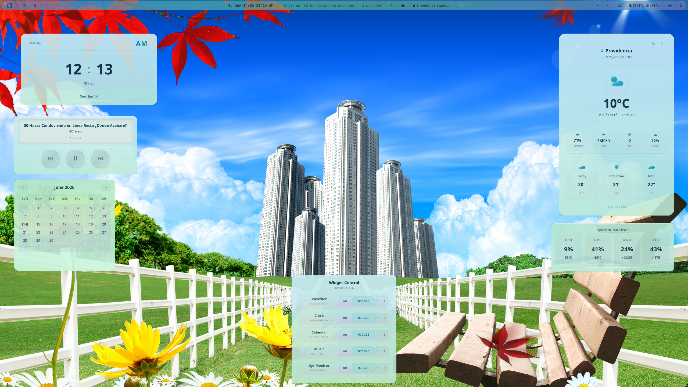
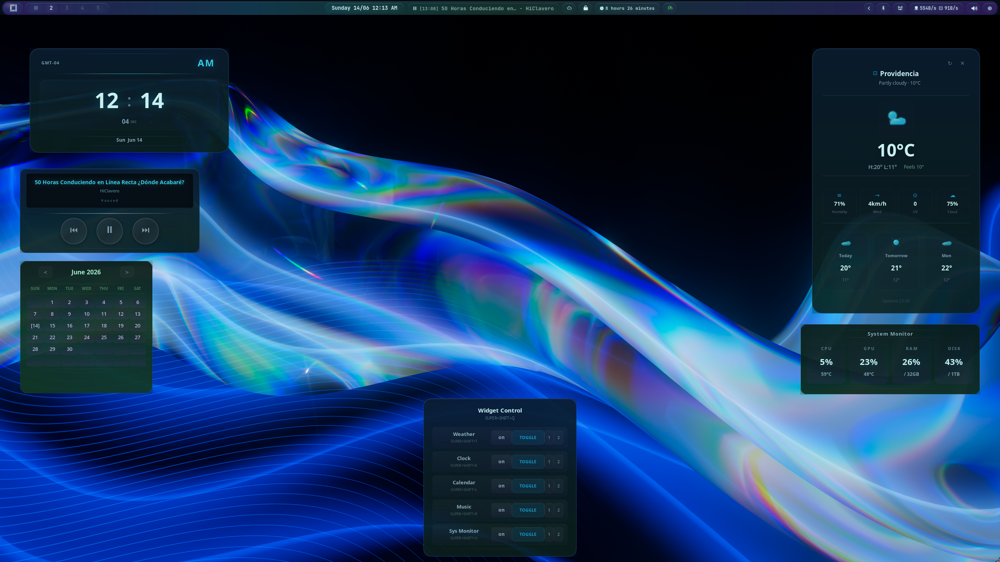
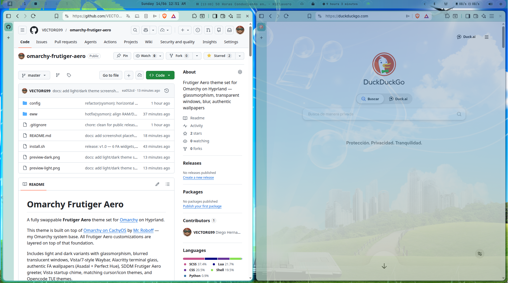
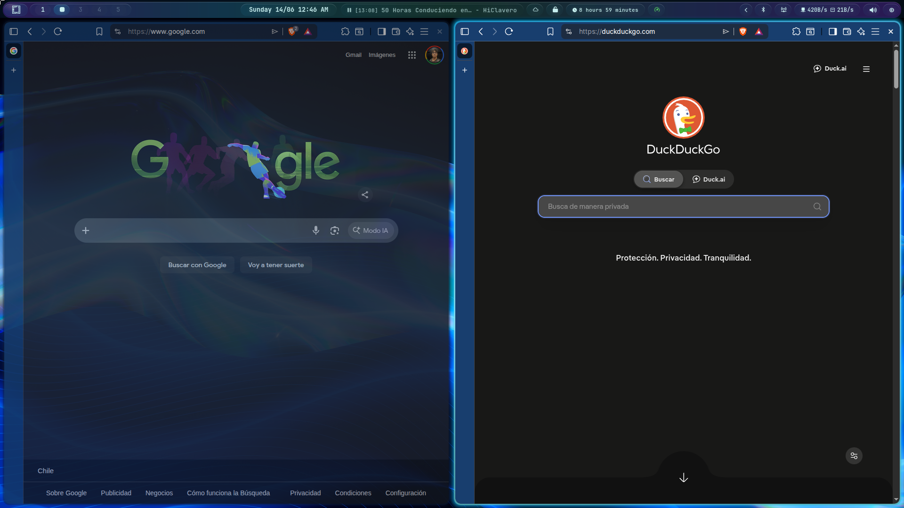

<div align="center">

# 🪟 Omarchy Frutiger Aero — Extras

### The dark variant, desktop configs and EWW widgets for the Frutiger Aero theme

[](LICENSE)
[](https://github.com/VECTORG99/omarchy-frutiger-aero-extras/stargazers)
[](https://github.com/VECTORG99/omarchy-frutiger-aero-extras/issues)
[](https://hyprland.org)
[](https://github.com/omacom/omarchy)

**Glassmorphism · Translucent windows · Vista/7-style Waybar · 7 EWW desktop widgets**

Light & dark variants — swappable via `omarchy theme set` — one-command install




</div>

---

Everything around the [Frutiger Aero theme](https://github.com/VECTORG99/omarchy-frutiger-aero) for [Omarchy](https://github.com/omacom/omarchy) that is code or replaces your own config: the dark variant, Vista-style Hyprland and Waybar configs, Waybar scripts and seven EWW widgets.

The theme itself has no code and installs on its own with `omarchy theme install https://github.com/VECTORG99/omarchy-frutiger-aero`. These extras are optional. `install.sh` overwrites files in `~/.config` (Hyprland, Waybar, Alacritty, GTK, Helix, Fastfetch, fontconfig, EWW), so read it before running it.

This theme is built on top of [Omarchy on CachyOS](https://github.com/roboff/omarchy-on-cachyos) by [Mr. Roboff](https://github.com/roboff) — my Omarchy system base. All Frutiger Aero customizations are layered on top of that foundation.

Includes light and dark variants with glassmorphism, blurred translucent windows, Vista/7-style Waybar, Alacritty terminal glass, Vista startup chime (optional, see [Issue #11](https://github.com/VECTORG99/omarchy-frutiger-aero/issues/11)), and matching cursor/icon themes.

Both variants switch with `omarchy theme set`. `install.sh` installs the light theme from its own repository and the rest from here.

## ✨ Features at a glance

| Feature | Light | Dark |
|---------|-------|------|
| **Glassmorphism** | Teal `#5AACA0` bg, 40% opacity | Navy `#0A1A2E` bg, 85% opacity |
| **Waybar** | Vista/7 pill bar with FA gradient | Same + glow on hover |
| **Window borders** | Frutiger Aero teal accent | Navy accent + 72% inactive opacity |
| **Lockscreen** | Rounded input, teal glow, live clock | Same |
| **Terminal** | Alacritty 85% opacity, JetBrains Mono | Same |
| **Widgets** | 7 EWW widgets (weather, clock, music…) | Same |
| **Startup sound** | Optional Vista chime (bring your own `.wav`) | Same |

## Preview

| Light (`frutiger-aero`) | Dark (`frutiger-aero-dark`) |
|------------------------|-----------------------------|
|  |  |
| Teal `#5AACA0` bg, `#1A3344` fg | Navy `#0A1A2E` bg, `#C8F0F0` fg |
| Medium saturated teal + dark text | Deep navy + light teal text |

### Glass transparency

| Light | Dark |
|-------|------|
|  |  |

### Light palette

| Token | Color | Hex |
|-------|-------|-----|
| Background | Medium teal | `#5AACA0` |
| Foreground | Dark navy | `#1A3344` |
| Accent | Blue | `#1299CA` |
| Yellow (ANSI 3) | Amber | `#A08020` |
| Comments | Dark blue-gray | `#1A3A48` |

### Dark palette

| Token | Color | Hex |
|-------|-------|-----|
| Background | Deep navy | `#0A1A2E` |
| Foreground | Light teal | `#C8F0F0` |
| Accent | Cyan-blue | `#35BCDE` |

## Visual features

### Waybar (Vista/7-style pill bar)

- **Height**: 36px (auto-expands to 39px min with margin)
- **Background**: Translucent teal at 40% opacity with FA decorative gradient overlay (purple → blue → green → blue → purple)
- **Shape**: Pill modules with `border-radius: 14px`, individual glass gradient backgrounds with white shine (`inset 0 1px 0`)
- **Hover**: Glow effect on all modules (box-shadow + brighter gradient)
- **Workspaces**: Pulse animation (`orb-pulse` 3s) on occupied workspaces
- **Start button**: Radial-gradient omarchy icon on left
- **Bar decorative**: FA bubble gradient visible through translucent background

**Modules:**
- `custom/omarchy` — Start menu button
- `hyprland/workspaces` — Workspace indicators with pulse
- `custom/clock` — Custom script (12h, English locale, AM/PM) horizontal + vertical
- `mpris` — Media player with player-icons (Spotify , mpv/vlc , Firefox ), position via `{dynamic}`
- `idle_inhibitor` — Toggle idle (lock/unlock icons, green glow when active)
- `custom/weather` — Current weather
- `custom/update` — Package update indicator
- `custom/uptime` — System uptime
- `custom/power-profile` — Cycle power modes (power-saver/balanced/performance)
- `custom/network-speed` — Download/upload via `/proc/net/dev`
- `custom/voxtype` — Voice recording/transcription indicator
- `custom/screenrecording-indicator` — Screen recording status
- `custom/notification-silencing-indicator` — DND toggle
- `tray`, `bluetooth`, `network`, `pulseaudio`, `cpu`, `battery` — System indicators

### Hyprland

- **Border**: 3px width, `rounding_power: 2.5`
- **Active window**: 3-color gradient border (teal → cyan → aqua)
- **Inactive windows**: `opacity 0.72` with blur
- **Shadow**: Teal glow, `range: 14`
- **Animations**: `faBounce` custom bezier curve for windows
- **Workspaces**: Slide animation
- **Layer blur**: Enabled for mako notifications

### Hyprlock (lockscreen)

- **Frutiger Aero redesign**: Rounded input field (16px radius) with teal glow shadow
- **Live clock/date**: Middle of screen
- **"Welcome back"**: Greeting above input
- **Blur**: 4 passes, size 12, over current wallpaper

### Hypridle

- 5min → Brightness 10%
- 10min → Lock screen
- 15min → DPMS off
- 20min → Suspend

### Alacritty (terminal)

- **Opacity**: 85% (wallpaper shows through)
- **Font**: JetBrainsMono Nerd Font 10.5px
- **Theme**: Imports omarchy active theme colors

### Startup sound

Vista startup chime plays 2s after login via `paplay --volume=45000` (autostart.lua). The `.wav` file is **not included** in the repo (copyright concerns) — place it at `~/.config/omarchy/sounds/vista-startup.wav` to enable. The autostart script skips silently if the file is missing.

### Icons & Cursors

- **Icons**: Yaru-prussiangreen (dark teal-green glossy, Frutiger Aero match)
- **Cursor**: Bibata-Modern-Ice (ice blue glass)

### Fonts

- **System**: [Fira Sans](https://fonts.google.com/specimen/Fira+Sans) 10px
- **Terminal/editor**: [JetBrains Mono Nerd Font](https://www.nerdfonts.com/font-downloads)
- **Fontconfig**: `hintslight`, `rgba=rgb`, `lcdfilter=default`

### Fastfetch

- Modified `keyColor` from `magenta` to `yellow` for contrast on teal backgrounds

### Wallpapers

No wallpapers are bundled. The Frutiger Aero wallpapers this theme was made with are not freely licensed, so they were removed. Add your own to `~/.config/omarchy/backgrounds/<theme>/`.

## What's included

```
config/
├── hypr/                    # Hyprland: look and feel, bindings, autostart, idle, lock
├── waybar/                  # Vista/7 pill bar: config.jsonc, style.css, scripts/
├── alacritty/               # 85% opacity terminal
├── fontconfig/              # Fira Sans, hinting
├── gtk/                     # GTK icon/cursor theme
├── helix/                   # Editor colors
├── fastfetch/               # System info display
└── omarchy/themes/
    └── frutiger-aero-dark/  # Dark variant
eww/                         # 7 desktop widgets (weather, clock, music…)
scripts/                     # Shell helpers shared by Waybar and EWW
install.sh                   # Installer
```

## Installation

```bash
git clone https://github.com/VECTORG99/omarchy-frutiger-aero-extras.git
cd omarchy-frutiger-aero-extras
less install.sh   # read it first
./install.sh
```

The installer runs `omarchy theme install` for the light theme, copies the dark
variant to `~/.config/omarchy/themes/frutiger-aero-dark`, copies the configs and
widgets, keeps your existing `input.lua` and `monitors.lua`, and reloads Hyprland
and Waybar.

## EWW Widgets

Seven Frutiger Aero desktop widgets built with [EWW](https://github.com/elkowar/eww) 0.5+:

| Widget | Keybind | Description |
|--------|---------|-------------|
| **Weather** | `SUPER+SHIFT+T` | Auto-location forecast via wttr.in, 3-day outlook, glass-minimal SVG icons |
| **Clock** | `SUPER+SHIFT+K` | 12h digital clock with date, timezone, glossy separators |
| **Calendar** | `SUPER+SHIFT+L` | Monthly calendar with `< >` navigation, today marked `[day]` |
| **Music** | `SUPER+SHIFT+R` | Now playing via playerctl, Pioneer car stereo style, LCD display |
| **System Monitor** | `SUPER+SHIFT+U` | CPU/GPU/RAM/DISK with rounded percentages and temps |
| **Opacity** | `SUPER+SHIFT+V` | Slider to control inactive window opacity (0-100%), presets, persists across reloads |
| **Control** | `SUPER+SHIFT+Q` | Toggle any widget on/off, per-widget screen selector [1][2], shows status and keybinds |

All widgets support light/dark themes via `omarchy theme set`.

### Widget dependencies
```
eww 0.5+  playerctl  python3  curl  nvidia-smi  lm-sensors  pulseaudio/pipewire
```

## Contributing

Contributions are welcome! Please read [CONTRIBUTING.md](docs/CONTRIBUTING.md) for guidelines on PRs, code style, and testing.

### Quick start for contributors

```bash
git clone https://github.com/VECTORG99/omarchy-frutiger-aero-extras.git
cd omarchy-frutiger-aero-extras
git checkout -B feat/your-feature origin/master
# make changes
shellcheck config/waybar/scripts/*.sh eww/scripts/*.sh install.sh
luac -p config/hypr/*.lua
git push -u origin feat/your-feature
gh pr create
```

### Testing commands

| Command | What it checks |
|---------|---------------|
| `shellcheck config/waybar/scripts/*.sh eww/scripts/*.sh install.sh` | Bash scripts |
| `luac -p config/hypr/*.lua config/omarchy/themes/*/*.lua` | Lua syntax |
| `jq . config/waybar/config.jsonc` | Waybar JSON |
| `bash -n install.sh` | Install script syntax |

## Acknowledgements

- **[Omarchy](https://github.com/omacom/omarchy)** — the Hyprland meta-distribution this theme is built for
- **[Omarchy on CachyOS](https://github.com/roboff/omarchy-on-cachyos)** by [Mr. Roboff](https://github.com/roboff) — system base
- **[EWW](https://github.com/elkowar/eww)** — ElKowar's Wacky Widgets for desktop widgets
- **Frutiger Aero community** — for keeping the aesthetic alive since 2007

## License

[MIT](LICENSE) — Copyright (c) 2026 Diego Hernandez.
